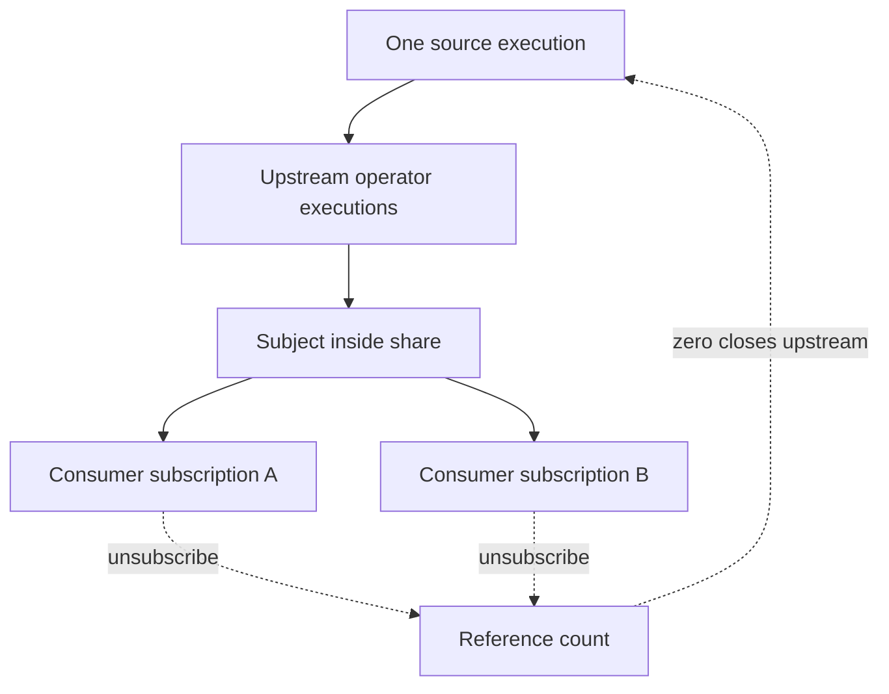

# How `lift()` can support an RxJS debugger

**Analysis date:** 13 November 2026, Europe/Zurich

**Implementation examined:** RxJS **7.8.2**

**Main contributor and co-author:** ChatGPT — GPT-6 Astra

**Project direction and co-author:** Hans Schenker

## Purpose and evidence

`lift()` gives a debugger a common place to discover operator connections and install probes that observe those connections when they execute. Such a debugger can show what entered each operator, what it emitted, when connections started and ended, which inner subscriptions were replaced, and where values stopped flowing.

The essential distinction is that **`lift()` exposes the construction of an operator connection; the probes installed through it expose the later execution**. Explaining an operator's decisions requires a further layer of metadata, instrumentation, or a semantic model.

This analysis was prompted by Ben Lesh's discussion in [*How To Build Your Own RxJS Operators*, with Tracy Lee, at 17:43](https://www.youtube.com/watch?v=E6R_1QB8q4o&t=1063). The video and timestamp identify the user's reference. A transcript of that passage was not independently retrieved, so this document does not claim to reproduce its wording. The technical explanation is based on the tagged RxJS 7.8.2 source.

Ben described the architectural intention directly in [RxJS issue #2911](https://github.com/ReactiveX/rxjs/issues/2911): `lift` supplied a centralized hook for “(almost) all operators” that could support reporting and tooling. He also acknowledged that some operators bypassed it. That qualification matters throughout this design.

Repository companions:

- [Canonical TypeScript recorder](../src/lift-recorder.ts).
- [Executable verification cases](../tests/verify.cjs).
- [Verification results and limits](verification.md).
- [Source index](sources.md).

## 1. Start with what the debugger should show

Consider a dataflow with four stages:

| Stage | Responsibility | Values passing its output |
|---|---|---|
| Source | Emit three numbers synchronously | `1, 2, 3` |
| `map` | Double each number | `2, 4, 6` |
| `filter` | Accept numbers greater than two | `4, 6` |
| `scan` | Accumulate a running total, starting from zero | `4, 10` |

Assume an ordinary cold source and one subscription. No sharing is introduced. The source determines when the input values arrive; these three operators process each received value synchronously in this example.

A debugger should let someone select `filter` and inspect its incoming and outgoing notifications:

| Incoming value | Outgoing value | Explanation from the known filter policy |
|---|---|---|
| `2` | No value | Predicate rejected it |
| `4` | `4` | Predicate accepted it |
| `6` | `6` | Predicate accepted it |

Selecting `scan` should reveal a different relationship:

| Incoming value | Previous accumulated value | Next accumulated value | Outgoing value |
|---|---|---|---|
| `4` | `0` | `4` | `4` |
| `6` | `4` | `10` | `10` |

These tables contain two kinds of information. **Boundary observations** say that an input arrived or an output departed. **Behavioral explanations** say that a predicate rejected an input or an accumulator changed.

Boundary observation can be implemented generically. Behavioral explanation needs knowledge of the operator, its configuration, or its actual internal operations. A generic recorder cannot conclude that an input was rejected merely because an output has not appeared yet: another operator might retain, queue, delay, or combine that input.

The application domain can change while the recording machinery stays the same. The probes observe notifications and connection lifetimes; user functions continue to supply domain-specific predicates, projections, and reducers.

## 2. Separate pipeline construction from execution

For standard RxJS 7.8.2 operators built with `operate()`, several things happen at different moments:

| Moment | RxJS action | Possible debugger record |
|---|---|---|
| Call an operator factory, such as `filter(predicate)` | Configure an operator function | Name, configuration, and source location, if this call is instrumented |
| Apply that function to a source, normally through `.pipe()` | `operate()` calls `source.lift(...)` | A source/result connection |
| Subscribe to the result | Invoke the stored operation | A new activation of that connection |
| Receive notifications | Pass them through the operator's Subscriber logic | Input, output, errors, completion, and timing |
| Close a connection | Execute registered teardown | Cancellation and lifetime information |

In [RxJS 7.8.2 `Observable.ts`](https://github.com/ReactiveX/rxjs/blob/7.8.2/src/internal/Observable.ts), `lift()` creates a result Observable and stores two pieces of information on it:

- `result.source`: the preceding Observable.
- `result.operator`: the operation that will establish the connection when subscribed.

Later, `Observable.subscribe()` invokes the stored operation using `operator.call(subscriber, source)` and attaches its returned teardown to the subscriber. The debugger can therefore record structure when `lift()` runs and arrange to record execution when the stored operation is invoked.

### The role of `operate()`

The responsibilities can be given descriptive names:

- `operate()`, or conceptually `createPipeableOperator()`, packages the operator's connection logic.
- `lift()` attaches that packaged logic to a source and creates the result Observable.
- `subscribe()` activates the packaged logic.

There is a calling-convention detail that instrumentation must preserve. [`operate()`](https://github.com/ReactiveX/rxjs/blob/7.8.2/src/internal/util/lift.ts) passes a function to `lift()`. When RxJS later invokes it through `.call(...)`, the function's `this` is the destination Subscriber, and its argument is the source Observable. `operate()` then invokes its initialization function with those two values.

Older operator objects expose a `call` method, while the function installed by `operate()` has JavaScript's function `call` mechanism. A wrapper that forwards `originalOperation.call(destination, source)` can preserve this protocol.

**Recording a `lift()` call does not mean that stream values have flowed.** It means another part of the dataflow has been described. For a live source, its external producer may already be active; the connection being described still has its own subscription lifecycle.

## 3. Record the construction graph

The first useful debugger feature requires no value interception. Whenever a source is lifted, record the source Observable's identity, the result Observable's identity, their connection, and any available operator label and source location.

For the introductory example, this supplies the static relationships between the source, `map`, `filter`, and `scan`. A `WeakMap` can assign identities to Observable objects without placing debugging properties on them.

**Observable identity and execution identity must remain separate.** Two subscriptions to the same cold pipeline reuse its construction graph, but start separate source executions and separate `scan` accumulators.

| Identity | Meaning |
|---|---|
| Observable/node ID | A particular dataflow description |
| Activation ID | One invocation of an operator's connection logic |
| Connection ID | A particular subscribed input or output boundary |
| Event ID | One recorded occurrence, such as `next(4)` |

A larger debugger should also distinguish the operator application written in the user's code from the internal Observable nodes it creates. A composed operator can create multiple stages, while an identity case can create none. Repeated equal values also need separate event identities; payload equality does not establish causality.

### Discovering meaningful operator names

`lift()` does not receive a description such as `{ name: 'filter', predicate: isEven }`. It receives an operation function or object. With `operate()`, that function is a closure, and its function name does not reliably identify the public operator or expose its configuration.

For example, [RxJS 7.8.2 `concatMap`](https://github.com/ReactiveX/rxjs/blob/7.8.2/src/internal/operators/concatMap.ts) delegates to `mergeMap` with concurrency one. Inspecting the resulting operation does not reliably recover the operator name the user wrote. Minification makes name-based guesses less dependable still.

There are three practical ways to supply names:

1. **Explicit annotations:** label an application, such as `filter(aboveTwo)`.
2. **Operator-factory wrappers:** record which factory was called and which configuration it received.
3. **A development build transform:** insert metadata at operator calls, including source locations.

Explicit annotations are a useful starting point for teaching. Automatic source instrumentation can follow once the event and connection models are reliable.

The hook itself can be installed through a specialized Observable's `lift()` override, a development-time prototype wrapper, or a controlled RxJS debug build. Each has different coverage. The prototype in this repository uses a small functional wrapper around `Observable.prototype.lift`.

## 4. Observe the real input and output connections

The next step decorates the operation stored by `lift()`. When that operation is activated, the debugger places an input probe between the source and the operator, and an output probe between the operator and its destination.

| Boundary | Probe responsibility |
|---|---|
| Source → operator | Record incoming notifications and forward them |
| Operator → destination | Record outgoing notifications and forward them |
| Connection lifetime | Record start and closure |

The original operator still decides what to emit. This resembles putting `tap()` before and after an operator, with instrumentation installed automatically through a common construction point.

A low-level implementation should avoid ordinary `tap()` calls inside the patched `lift()`: `tap()` can call `lift()`, causing recursive instrumentation. The repository example uses `Observable` and `Subscriber` directly for the probes.

### Observe an existing execution

The debugger must not add a second subscription to the application source merely to collect values. With a cold source, another subscription can start another execution: it can duplicate a request, repeat a calculation, or observe a different sequence.

The probe instead forwards notifications along the connection already requested by the application. This distinction between tracing inside an execution and creating another execution is also explained in [André Staltz's historical discussion of RxJS debugging](https://staltz.com/how-to-debug-rxjs-code.html).

### Event records and ordering

| Field | Purpose |
|---|---|
| `sequence` | Establish observation order, including identical timestamps |
| `time` and clock identity | Position an event in real or virtual time |
| `node` | Identify its operator boundary |
| `activation` | Identify the invocation of connection logic |
| `connection` | Identify this input/output subscription |
| `kind` | Start, next, error, complete, or close |
| `value` / `error` | Preserve the observed payload |
| Optional `cause` | Relate an event to its triggering event |

Recording a notification before forwarding it makes synchronous causal order easier to read: an input is recorded before the operator's resulting output. A more advanced recorder can capture entry and return to show nested delivery and reentrancy.

Entry/return timing must be interpreted carefully. Time inside a `next()` call can include all the downstream work that call invokes. It does not automatically measure the selected operator's own computation.

## 5. Preserve cancellation before connecting upstream

An instrumentation wrapper can display the correct final values while changing upstream work. This is the most important correctness risk in a forwarding probe.

Consider a synchronous source that loops over values while its Subscriber remains open. Put `take(1)` downstream. The intended sequence is: produce one value, deliver it, complete the result, close upstream, and stop the loop.

A naïve probe subscribes with a plain forwarding observer and returns the resulting subscription afterward. For a synchronous source, that attachment can happen too late: the source may have finished its entire loop before the upstream subscription becomes a child of the destination.

The following comparison was checked against RxJS 7.8.2:

| Probe design | Values produced by the source | Values received after `take(1)` |
|---|---|---|
| Plain forwarding observer, linked after `subscribe()` returns | `1, 2, 3, 4, 5` | `1` |
| Subscriber linked before connecting upstream | `1` | `1` |

Inspecting only the final output hides the defect in the first wrapper.

### Required construction order

The probe must create a real forwarding Subscriber, attach it to the destination's subscription, register its closure observation, and only then subscribe it to the source.

RxJS's [`Subscriber`](https://github.com/ReactiveX/rxjs/blob/7.8.2/src/internal/Subscriber.ts) links itself immediately when constructed with another Subscriber. The relationship can also be established explicitly with `destination.add(probe)`. [`Subscription.add`](https://github.com/ReactiveX/rxjs/blob/7.8.2/src/internal/Subscription.ts) also handles the already-closed case by executing newly added finalization logic immediately.

The probe must preserve stopped/closed handling, error identity, notification order, and returned teardown. Recorder failures must be isolated from application errors. Instrumentation should never invoke a user function a second time or create an extra application subscription.

### Completion and cancellation are different events

For `source → take(1)`, the output of `take(1)` completes while the upstream connection is canceled. Unsubscription does not itself send `complete`.

Finalization alone therefore cannot say whether a boundary completed, errored, or closed without either notification. The recorder must remember the terminal notification, if any, before reporting closure. These behaviors are implemented in [Subscriber.ts](https://github.com/ReactiveX/rxjs/blob/7.8.2/src/internal/Subscriber.ts).

Even a correctly classified closure does not automatically explain its cause. “Closed without completion or error” is an observation. “Canceled because `switchMap` received a newer value” requires a causal relationship or semantic instrumentation.

Likewise, observing a closed subscription does not establish that every external resource has finished shutting down. A source adapter is needed to report a physical resource action such as a network abort separately from subscription cancellation.

## 6. Separate timing observations from internal state

Boundary probes do not generically expose private variables. [`debounceTime`](https://github.com/ReactiveX/rxjs/blob/7.8.2/src/internal/operators/debounceTime.ts), for example, holds its pending value, most recent input time, and scheduled task in local variables inside its connection logic. A generic `lift()` hook cannot enumerate that closure's environment.

| Visibility level | Example |
|---|---|
| Observed boundary event | Input `"b"` arrived at time `2` |
| State reconstructed from a known policy | Pending value is `"b"`; silence deadline is `7` |
| Instrumented implementation event | A particular scheduled action executed and rescheduled itself |

The UI should label these distinctions. A model's reconstructed state is useful, but it must not be presented as a direct inspection of implementation state.

### A debounce timeline

With a duration of five virtual time units:

| Virtual time | Observed event | Explanation from the debounce policy |
|---:|---|---|
| `0` | Input `"a"` | Retain `"a"`; silence deadline becomes `5` |
| `2` | Input `"b"` | Replace the pending value; deadline becomes `7` |
| `7` | Output `"b"` | Required silence has elapsed |
| `10` | Input `"c"` | Retain `"c"`; deadline becomes `15` |
| `11` | Source completes | Flush `"c"` immediately, then complete |

The prototype can record the boundary events. A semantic model supplies the policy explanation. Scheduler instrumentation supplies the actual task events.

RxJS 7.8.2 does not necessarily cancel and create a new timer on every input. It updates the latest input time and can let an existing action wake up and reschedule itself. “The silence deadline moves” describes the policy; a claim about physical timer operations requires scheduler observations. See [debounceTime.ts](https://github.com/ReactiveX/rxjs/blob/7.8.2/src/internal/operators/debounceTime.ts).

### Scheduler instrumentation

Record which activation scheduled an action, when scheduling occurred, the requested due time, actual execution, rescheduling, and cancellation. Use the scheduler's clock for virtual-time experiments, and retain an event sequence number because several events can occupy the same time point.

A scheduler wrapper must preserve action context and rescheduling behavior. Watching only the initial `scheduler.schedule()` call misses subsequent calls through the action's own `schedule()` method. [AsyncAction.ts](https://github.com/ReactiveX/rxjs/blob/7.8.2/src/internal/scheduler/AsyncAction.ts) shows why the action lifecycle matters.

### Observe actual function decisions once

A debugger must not rerun a predicate, projection, or reducer simply to discover what it would return. The function may read changing state, perform effects, or throw. If its decisions need to be visible, wrap its actual invocation and record its arguments and result once. A separately defined semantic model is another option, with its assumptions stated explicitly.

## 7. Extend the execution graph for inner subscriptions and sharing

A running application can establish connections that did not exist when the pipeline was assembled.

### Inner subscriptions

A useful `switchMap` trace would show:

| Event | Execution consequence |
|---|---|
| Outer A arrives | Create inner connection A |
| Inner A emits | Forward its value |
| Outer B arrives | Close inner A, then create inner connection B |
| Inner B emits | Forward its value |
| Outer completes | Wait for the active inner to finish |
| Inner B completes | Complete the result |

The [tagged implementation](https://github.com/ReactiveX/rxjs/blob/7.8.2/src/internal/operators/switchMap.ts) explicitly closes the previous inner subscription and subscribes to the newly projected input. Output completion requires outer completion and no active inner.

The `lift()` hook sees the `switchMap` stage, but does not automatically identify every inner connection. An inner source can be created without a further lifted operator. A fuller debugger also observes subscription creation and relates outer events to inner connections, their notifications, and their closure.

A stack of current event contexts can establish immediate synchronous causality. Asynchronous work needs context propagated through scheduler or source instrumentation.

| Operator | Policy to display | Runtime information needed |
|---|---|---|
| `mergeMap` | Allow overlap | Active inners and any concurrency queue |
| `concatMap` | Queue | Active inner and waiting inputs |
| `switchMap` | Only latest | Replacement and cancellation relationships |
| `exhaustMap` | Ignore while busy | Busy interval and rejected outer inputs |

No output yet does not distinguish a queued input, an ignored input, and an inner source that has not emitted. Policy information and connection events make those explanations possible.

### Shared connections

The consumer that first establishes a shared source connection does not necessarily own its whole lifetime. For default `share()` while upstream remains active:



If A unsubscribes while B remains, upstream continues. When the reference count reaches zero, default `share()` tears down that active connection. Other reset configurations require their own interpretation.

RxJS 7.8.2's [`share()`](https://github.com/ReactiveX/rxjs/blob/7.8.2/src/internal/operators/share.ts) does use `operate()` and `lift()`. It also maintains a separate upstream connection and shared state. An input probe installed during A's activation can therefore remain active after A's output subscription closes.

The debugger needs an identity for that shared connection and links from both consumers to it. A simple tree in which one output activation owns all its upstream activity produces misleading lifetime diagrams.

## 8. Build the debugger views from the event records

Reliable events and relationships support several complementary views.

### Graph inspection

Selecting a node can show its operator configuration and source location, active and closed subscriptions, upstream and downstream connections, active inners, and shared-source relationships. The construction graph answers what was described; the execution graph answers what is currently connected.

### Four aligned timeline lanes

| Lane | Contents |
|---|---|
| Inputs | Source, notifier, and inner notifications |
| State | Observed state or clearly labeled reconstructed state |
| Outputs | Values, errors, and completion |
| Control | Subscribe, cancel, schedule, execute, reschedule, and close |

These lanes let the reader ask, at one moment: which input arrived, what state changed, which action followed, and which connection or scheduled task changed?

The debugger can itself use an event stream and a reducer: `scan` derives graph and view state, and an explicitly configured `shareReplay` distributes the latest state to its views. Recording, state reduction, and rendering should remain separate responsibilities.

Exclude the debugger's own streams from application instrumentation. Otherwise, recording an event can generate more instrumented events. Use bounded retention and batch UI updates for high event rates. Also distinguish a retained value reference from an immutable snapshot: an object saved in a trace may later be mutated by application code.

Instrumentation adds work. Preserve the notification and cancellation protocol, but do not claim zero timing overhead. Controlled virtual-time experiments are especially useful for comparing temporal behavior.

### Breakpoints, history playback, and re-execution

| Feature | Meaning |
|---|---|
| Conditional breakpoint | Pause JavaScript on a chosen notification or lifecycle event |
| History playback | Move through recorded events and redraw earlier debugger state |
| Controlled re-execution | Run again with controlled inputs and scheduling |

A breakpoint can pause immediately before forwarding a value. Wall time can still pass while JavaScript is paused, affecting real-time deadlines. History playback can inspect recorded states without executing the source again. Re-execution requires control over inputs, scheduling, and effects; a trace does not undo effects that already occurred.

[rxjs-spy](https://github.com/cartant/rxjs-spy) documents instrumentation attached to `Observable.prototype.subscribe`, with logging, graphs, snapshots, breakpoints, and notification buffering. Its pause feature buffers delivery, which differs from stopping the producer. [RxJS Insights](https://github.com/ksz-ksz/rxjs-insights) distinguishes construction calls, operator calls, subscribers, events, causal relationships, and asynchronous tasks. These are precedents for the broader architecture, not evidence that either tool is implemented solely through `lift()`.

## 9. Connect execution traces to operator specifications

The recorder can provide evidence for **Intuition → Specification → Verification**. For a selected operator, load its behavioral model, feed the recorded input and lifecycle events into it, derive allowed transitions and expected actions, and compare them with observed outputs and connection changes.

For `switchMap`, relate a new outer event to closure of the previous inner. For `debounceTime`, explain why completion flushed a pending value before its silence deadline. The model needs relevant timing, inner, and notifier events; a log that omits them may be insufficient to check the behavior.

| Item | What it establishes |
|---|---|
| Operator model | Allowed behavior under stated assumptions |
| Recorded trace | What instruments observed during one execution |
| Trace comparison | Whether the observed execution agrees with the model |
| Broader verification | Evidence across more executions or proof under a formal model |

A finite trace can expose a counterexample. Agreement on a trace does not establish correctness for every execution, and an unfinished trace can leave an eventual-completion obligation unresolved.

This connects the debugger to the project chain **State → Step → Trace → Behavior → Specification → Implementation → Verification**. Reconstructed model state and actual implementation observations must remain distinguishable throughout that chain.

There is also a protocol-observation boundary. Ordinary Subscriber probes see accepted notifications. If a producer attempts to send after closure, Subscriber normally suppresses delivery. Diagnosing the invalid attempt requires instrumentation before suppression, rather than relying only on downstream events. See [Subscriber.ts](https://github.com/ReactiveX/rxjs/blob/7.8.2/src/internal/Subscriber.ts).

## 10. Define the coverage of the `lift()` adapter

A whole-application debugger needs several hooks:

| Case | Why another mechanism is needed |
|---|---|
| Direct `Subject.pipe(...)` | `Subject` has its own `lift()` override |
| Source creation | Creating an Observable need not call `lift()` |
| Custom operators | They can return `new Observable(...)` directly |
| Identity cases | Some applications create no lifted node |
| Inner and notifier sources | Connections can arise dynamically |
| Multiple RxJS copies | Patching one prototype does not patch another copy |
| Previously constructed pipelines | Their stored operations already exist |

RxJS 7.8.2's [`Subject.lift()`](https://github.com/ReactiveX/rxjs/blob/7.8.2/src/internal/Subject.ts) creates an `AnonymousSubject` and installs the operation itself. Patching only the base Observable method misses that path.

Other concrete cases are [`tap()` without a handler](https://github.com/ReactiveX/rxjs/blob/7.8.2/src/internal/operators/tap.ts), which returns the identity operation, and [`take(0)`](https://github.com/ReactiveX/rxjs/blob/7.8.2/src/internal/operators/take.ts), which returns `EMPTY` without connecting the original source.

The broader design should separate these components:

| Component | Responsibility |
|---|---|
| Operator metadata adapter | Names, configuration, and source locations |
| Construction adapter | Observable nodes and static connections |
| Subscription adapter | Actual connections, notifications, and closure |
| Scheduler adapter | Time and scheduled actions |
| Semantic adapters | Operator-specific state and explanations |
| Recorder and UI | Storage, inspection, comparison, and visualization |

This also isolates version dependence. [RxJS 7.8.2 `Observable.ts`](https://github.com/ReactiveX/rxjs/blob/7.8.2/src/internal/Observable.ts) marks `lift`, `source`, and `operator` as deprecated implementation details. The experiment is deliberately pinned to this version. A historic source comment about a future release should not be treated as evidence about the current release's implementation.

## 11. Read and run the small recorder

The complete implementation is maintained in [src/lift-recorder.ts](../src/lift-recorder.ts). It records source/result node relationships, separate activations, input/output connections, values, errors, completion, closure, sequence numbers, and an injectable clock.

Its scope is ordinary Observable pipelines in RxJS 7.8.2. It patches only `Observable.prototype.lift`; the other coverage mechanisms above remain separate design work.

The core interception is:

```ts
output.add(
  operation.call(
    output,
    observeInput(source, context)
  )
);
```

`observeInput` supplies an observed source connection. `output` is an observed destination Subscriber. The original operation establishes its normal connection between them, and `output.add` attaches the returned teardown.

Each responsibility has a small named function:

| Function | Responsibility |
|---|---|
| `getNodeId` | Assign stable identity to an Observable object |
| `recordEvent` | Append an event while isolating recorder failures |
| `createProbe` | Forward notifications and preserve cancellation linkage |
| `observeInput` | Observe the actual upstream connection |
| `applyLift` | Delegate to the captured original method |
| `recordedLift` | Record construction and install the operation wrapper |

Install the recorder before constructing the pipeline:

```ts
import { of, map, filter, scan } from 'rxjs';
import { installLiftRecorder } from './src/lift-recorder';

const recorder = installLiftRecorder();

const result$ = of(1, 2, 3).pipe(
  map(value => value * 2),
  filter(value => value > 2),
  scan((total, value) => total + value, 0)
);

const values: number[] = [];
result$.subscribe(value => values.push(value));

console.log(values); // [4, 10]
console.table(recorder.nodes);
console.table(recorder.events.filter(event => event.kind === 'next'));

recorder.restore();
```

This usage snippet is illustrative TypeScript; use the repository scripts described in the README to compile the recorder and execute the maintained verification cases.

The boundary records contain inputs `1, 2, 3` and outputs `2, 4, 6` for `map`, inputs `2, 4, 6` and outputs `4, 6` for `filter`, and inputs `4, 6` and outputs `4, 10` for `scan`. The prototype uses generated node IDs; descriptive names belong to the metadata adapter.

### Verification and limits

The prototype was compiled under strict TypeScript checking and exercised against RxJS 7.8.2. The eight preserved cases cover boundary values, synchronous cancellation, error identity, early unsubscription, independent repeated subscriptions, virtual-time debounce behavior, shared-source lifetime, and the `Subject.lift()` coverage gap. The [verification document](verification.md) records the reproducible commands and results.

These checks establish the named cases, not universal transparency. In particular:

- `run` means the activation in which a probe was installed. A shared input connection can outlive that activation's output connection.
- Values are retained as references, not immutable snapshots.
- `close` reports a boundary closure, not completion of every external resource's shutdown.
- `restore()` restores future construction. Existing Observables retain their installed wrappers.
- Decorating the source changes the source object passed to operator logic. Arbitrary custom operators that depend on source identity require additional care.
- Direct Subscriber construction and prototype instrumentation are version-specific implementation techniques.

The next useful development increment is stable operator metadata plus an explicit subscription graph. Scheduler events and semantic adapters can then make policies visible without confusing observed execution with reconstructed explanation. Those additions would allow the same recorder to support practical debugging, operator teaching, and comparisons against the project's Mealy specifications.
